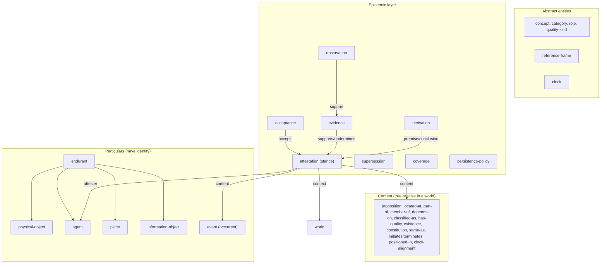
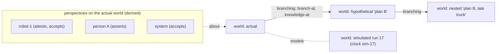

# World Ontology v0.1: architecture proposal

**Status: PROPOSAL for review (2026-11-09). Not approved. Nothing here is implemented.**
Branch `architecture/world-ontology-v0.1`. The Milestone 1 code on `main` is unchanged.

**Evidence labels** used throughout:
- **[V]** verified in a primary source or a TypeDB probe run for this project (`probes/`).
- **[M1]** demonstrated by Milestone 1's passing tests.
- **[K]** from the project's earlier research or general knowledge, not re-checked here.
- **[H]** a hypothesis: argued, not yet demonstrated.

Contents: 1 Objectives · 2 Commitments · 3 Foundations compared · 4 Taxonomy · 5 Relationships and invariants ·
6 Time, space, identity, epistemics · 7 Worlds, perspectives, reasoning · 8 TypeDB mapping · 9 Alternatives ·
10 Worked examples · 11 Milestone 1 gap analysis · 12 Open questions and risks · 13 Decision record

---

## 1. Design objectives and non-goals

**Objectives**
1. A small foundational ontology for physical, social, scientific, spatial, temporal and abstract domains, extended
   by profiles that never change what a core term means.
2. Persistent identity through change; existence per world.
3. Change through both events and states, with neither one required to explain the other.
4. A first-class epistemic layer: who says what, on what evidence, believed by whom, as known when.
5. Worlds (actual, hypothetical, simulated) kept distinct from perspectives and from knowledge snapshots.
6. Explicit, named inference and defeasible assumptions. Missing information is never evidence of absence.
7. A natural and efficient implementation in TypeDB 3.x, with ontology decisions kept separate from storage decisions.
8. Useful without an LLM or any external perception system.

**Non-goals (v0.1)**
- A catalogue of domain types (vehicles, minerals, emotions). Those belong in profiles.
- Full first-order axiomatisation or OWL-DL reasoning.
- Geometry, mereotopology of regions, or physics. Geometry stays in external systems, referenced by frame and pose.
- Probabilistic inference. Credences are recorded and compared only where calibrated.
- Causal discovery. Causation is recorded when someone asserts it, never inferred from succession.
- Modelling the *content* of minds beyond attitudes to propositions (no theory of intentions or emotions).

---

## 2. Ontological commitments and guiding principles

| # | Commitment | Consequence |
|---|---|---|
| C1 | **Descriptive, not realist.** The ontology structures *descriptions* of worlds by agents, including the system itself (DOLCE's stance [V]) | beliefs, hypotheses, fiction and simulation are first-class; "reality" is never written directly |
| C2 | **Three-dimensional particulars.** Endurants are wholly present whenever they exist and change by gaining and losing properties; occurrents unfold in time [V DOLCE] | one id per object across its whole life; temporal parts are not individuals |
| C3 | **Content and stance are separate.** *What* is said (a proposition, an event description) is distinct from *who* says or believes it, *when*, *in which world* and *on what evidence* | the central change from Milestone 1 (section 9) |
| C4 | **Time lives on stances, not on things.** Endurants have no valid time of their own; existence is itself a proposition | identity is timeless; existence is per world |
| C5 | **Types for robust kinds; propositions for everything that can change or be disputed** | uncertain labels and roles never fix a TypeDB type (single type per instance, no re-typing [V P1B-B]) |
| C6 | **Open world.** Absence of a record is never falsity; absence must be observed (coverage) to count | statuses UNKNOWN and NOT_YET_KNOWN |
| C7 | **Statuses belong to answers, not to stored facts.** OBSERVED, ASSERTED, INFERRED, PRESUMED and DISPUTED are computed for a question (world, perspective, valid time, transaction time, policies) | nothing stored needs rewriting when context changes |
| C8 | **Inference and presumption are explicit and named.** Every derived answer cites a rule or policy with a version; presumptions are never stored | answers are reproducible and auditable |
| C9 | **Minimal distinctions.** A category enters the core only when two domains need it and a counterexample fails without it | no process / action / system types in core (section 4.3) |

---

## 3. Foundational ontologies compared

Focused on the commitments this design depends on. DOLCE facts are from the 2022 *Applied Ontology* paper [V]. KnowRob
facts are from its source code [V]. BFO and SUMO facts are from earlier research [K].

| Commitment | DOLCE | BFO 2020 | SUMO | KnowRob / SOMA (DUL) | Milestone 1 |
|---|---|---|---|---|---|
| Stance | descriptive, cognitive [V] | realist [K] | broad, formal, encyclopaedic [K] | descriptive (DUL) [K] | descriptive by default |
| Top split | endurant / perdurant / quality / abstract [V] | continuant / occurrent [K] | physical (object, process) / abstract (attribute, proposition...) [K] | DUL object / event / quality / region / situation / description [K] | referent kinds; claims; events |
| Time | time-indexed relations: parthood P(x,y,t), participation PC(x,y,t), classification CF(x,y,t) [V] | temporalised relations ("at all times", "at some time") [V file names; K semantics] | `holdsDuring(time, formula)` [K] | time intervals on facts; `holds(p, t)` [V KnowRob] | valid-time windows on claims |
| Identity | 3D endurants; constitution separates co-located things (statue/clay) [V] | 3D continuants [K] | objects persist; little explicit identity theory [K] | as DUL; tracking left to perception [K] | minted ids; reviewable `same-as` |
| Events and processes | perdurants incl. events, processes, states (homeomeric) [V/K] | processes, process boundaries [K] | `Process` with subtypes; `agent`, `patient` case roles [K] | DUL events, actions, SOMA tasks and executions [K] | `event` relation with participant roles |
| Qualities | individual qualities located in quality spaces (quale) [V] | qualities as specifically dependent continuants; roles and dispositions as realizables [K] | attributes as abstract; measures via functions [K] | DUL quality + region [K] | `has-state` with concept |
| Roles | anti-rigid concepts linked by classification [V] | realizable entities [K] | case roles, social roles as attributes [K] | DUL concepts, roles [K] | `classified-as` concept |
| Uncertainty and conflict | none in the core [V scope] | none (realist) [K] | none [K] | BELIEF = a single materialised **best guess**; confidence = threshold; ego and other agents' perspectives [V] | statuses, proposals, reviews, DISPUTED |
| Executable in TypeDB | approximations only (OWL versions approximate the modal FOL [V]) | OWL/CL [V files] | KIF, first-order [V files] | Prolog + RDF [V] | yes [M1] |

### Adopt, adapt, reject
| Concept | Decision | Reason |
|---|---|---|
| Endurant / perdurant split (DOLCE, BFO) | **Adopt** | every domain distinguishes things from happenings |
| Descriptive stance (DOLCE, DUL) | **Adopt** | beliefs, fiction and simulation need it; BFO's realism cannot host them |
| Time-indexed relations (DOLCE) | **Adapt**: time moves from the relation to the *stance* (attestation), so different sources can give different intervals for the same content | conflicting sources on time (S, L examples) |
| Classification as a relation, roles as concepts (DOLCE) | **Adopt** | matches TypeDB's single-type rule [V]; handles changing and uncertain labels |
| Individual qualities and qualia (DOLCE) | **Adapt**: quality *kinds* are concepts; values are typed attributes; individual quality instances are **rejected** | no question in any scenario needs "this rose's colour" as an individual; value polymorphism works in TypeDB [V A2b] |
| Constitution (DOLCE) | **Adopt** as a core proposition | sampling (L), transformation (W: crate disassembled) |
| Realizables: dispositions, functions (BFO) | **Defer** to profiles | affordances matter to robots; no core question fails without them yet |
| Process boundaries, temporal regions (BFO) | **Reject** as individuals | windows on stances suffice |
| `holdsDuring` (SUMO) | **Adapt** as attestation intervals | same idea, executable |
| Descriptions and Situations (DUL) | **Reject** as reified individuals; keep the *idea* that descriptions are content an agent holds | too heavy for v0.1; propositions plus attestations cover it |
| BELIEF / KNOWLEDGE modalities, ego perspective (KnowRob) | **Adapt**: stances on attestations; the system is one agent | not novel; we differ by keeping alternatives instead of one best guess [V KnowRob comment] |
| Confidence threshold across sources (KnowRob) | **Reject** | scores are not comparable across sources without calibration |
| Milestone 1 "the relation is the claim" | **Replace** (section 9) | conflates content, stance and acceptance |

---

## 4. Foundational taxonomy and definitions

### 4.1 Overview


Four layers. Each foundational concept below lists: **meaning; distinct from; identity and existence; time; key
relationships; invariants; layer** (core or profile).

### 4.2 Particulars
**referent** (abstract). *Meaning:* anything the system can identify and talk about across records. *Distinct from:* a
name (a referent can have many, or none). *Identity:* a minted id, never reused; identity is timeless and
world-independent. *Existence:* only through `existence` propositions in a world (C4). *Time:* none intrinsic.
*Relations:* plays roles in propositions and events. *Invariant:* a referent's TypeDB type is a robust kind and never
changes. *Layer:* core.

**endurant** (abstract, sub referent). *Meaning:* a particular wholly present whenever it exists, able to change [V
DOLCE]. *Distinct from:* events (which unfold) and abstracts (which are not in time). *Identity:* as referent;
co-located endurants with different histories are distinct (statue vs clay, linked by `constitution`). *Layer:* core.

| Kind | Meaning | Distinct from | Notes |
|---|---|---|---|
| **physical-object** | a bounded material endurant (box, rock, rover, sample) | place (a physical object can *be* somewhere; a place is *where*) | substances (sand, water) as amounts are physical objects of a profile kind |
| **agent** | an endurant that can act intentionally and hold attitudes (persons, robots, software agents, organisations) | physical-object: a robot is *typed* agent; its physical facts are still propositions about it | single-type rule: choose agent when agency matters; physical roles are open to agents |
| **place** | a named location that can contain things and persist (room, shelf, crater, a vehicle cabin) | spatial region (geometry in a frame, external); places may move with their host (a cabin) | places nest via `part-of` |
| **information-object** | content-bearing artefact: message, document, video, dataset, map, log | observation (a record of an observing act); concept (an abstract category) | sources of testimony; maps and videos referenced by observations |

**event** (occurrent). *Meaning:* something that happens and unfolds over time, with participants in roles. Covers
achievements, processes, actions and activities. *Distinct from:* states, which are stative propositions holding over
an interval (section 4.5), and endurants. *Identity:* a minted id. Two sources describing "the same pickup" create two
event descriptions, linked by `same-as` once accepted, exactly as for endurants. *Time:* when it occurred is given by
attestations of its occurrence, possibly uncertain and possibly disputed. *Relations:* participant roles (actor,
patient, instrument, location, origin, destination); `part-of` between events (sub-events); `initiates` and
`terminates` link it to propositions. *Invariants:* an event has at least one participant. A participant's
participation is bounded by its existence: checked, not enforced. *Layer:* core. **Not core:** process, action and
activity as separate types. They are distinguished by classification and profile subtypes, until a counterexample
needs more (C9).

### 4.3 Abstract entities
**concept**. *Meaning:* a category, role, quality kind or other abstract classifier used to describe particulars
(DOLCE concepts and roles [V]). Subtypes: `category` (kinds, event kinds, state values such as *open*), `role`
(socially or functionally founded: *site manager*, *picker*), `quality-kind` (mass, colour, temperature).
*Distinct from:* TypeDB types, which hold only robust kinds. *Identity:* minted id; profiles publish concept sets.
*Time:* concepts are timeless in v0.1. *Layer:* core types; concept instances belong to profiles.

**reference-frame**. *Meaning:* a coordinate system in which positions are expressed (map, odom, base_link, a crater
grid, image pixels). *Identity:* minted id. Frames may be anchored to an endurant (a robot's base_link) by a
proposition. *Time:* the transforms between frames are propositions with valid time, and they can be corrected. *Layer:*
core, because "space and reference frames" are required.

**clock**. *Meaning:* a time reference system (wall UTC, one simulation run, one video's media time, one
conversation's turn order, a mission clock). *Identity:* minted id. *Relations:* `clock-alignment` propositions.
*Invariant:* times on different clocks are incomparable without an accepted alignment. *Layer:* core.

**world**. See section 7.

**Not core:** *system* (a whole with interacting parts and a function). Every system example (vehicle, warehouse,
organisation, ecosystem) is an endurant classified as a system, with `part-of` and `depends-on` structure. A separate
type adds no answerable question (C9). *Collections* likewise use `member-of`.

### 4.4 Content: propositions
**proposition** (abstract). *Meaning:* an atemporal, typed relational content that can be true or false in a world at
times: "box-17 is located at shelf-3". *Distinct from:* an attestation (someone saying it, with a time and stance), a
fact (a proposition true in a world at a time; never stored, only answered), and a state (a stative proposition
holding over an interval). *Identity:* by content. The type plus ordered role players gives a canonical
**proposition key**, unique in the database. *Time:* none intrinsic; intervals are on attestations. *Invariant:* one
instance per key (TypeDB-enforced with `@key`, section 8). *Layer:* core.

Core propositions (each with roles; *functional* means one value at a time per key role, used for exclusivity and
precedence):

| Proposition | Roles | Meaning | Functional? |
|---|---|---|---|
| `existence` | existent | the referent exists (start = creation, end = destruction) | — |
| `located-at` | located, place | symbolic location | yes, in `located` |
| `positioned-in` | positioned, frame; owns x, y, z, (orientation) | metric pose in a frame | yes, per (positioned, frame) |
| `part-of` | part, whole | composition (objects, places, events) | no |
| `member-of` | member, group | collection and organisational membership | no |
| `constitution` | constituent, constituted | what a thing is made from (sample from rock) | no |
| `depends-on` | dependent, dependee; optional kind | functional or existential dependency | no |
| `classified-as` | classified, class (concept), optional context | categories, roles in a context, state values | no (profiles may declare some classes exclusive) |
| `has-quality` | bearer, quality (quality-kind), optional value (category); owns a magnitude subtype + unit | qualitative or quantitative property value | yes, per (bearer, quality) |
| `same-as` | same ×2 | two referents (or event descriptions) are one | — |
| `initiates` / `terminates` | event, outcome (a proposition) | the event made the proposition start or stop holding | — |
| `clock-alignment` | from, to (clocks); owns offset, scale, uncertainty | how two clocks relate over a valid range | — |
| `frame-transform` | parent, child (frames); owns transform | how two frames relate over a valid range | yes, per (parent, child) |

**States are not a separate category.** A *state* is what a stative proposition (`located-at`, `has-quality`,
`classified-as`...) is called while an attestation holds it over an interval. A **process** is an event whose
occurrence interval may be open. This keeps events and states distinct (things happen; things hold) without
reifying states.

### 4.5 Facts, claims, states and events: how they relate (question A)
| Term | Is | Stored? |
|---|---|---|
| **proposition** | content: "box at shelf-3" | yes, once |
| **attestation** (claim) | an agent holds that proposition over an interval in a world, with a stance, polarity, basis and credence | yes, one per holding |
| **acceptance** | a perspective-holder's decision to accept or reject an attestation | yes |
| **fact** | a proposition true at t in a world, *according to a perspective* | **no**: it is an answer |
| **state** | a stative proposition under an accepted attestation, over its interval | **no**: it is a reading of the above |
| **event** | a particular that happened; its occurrence and time are attested | the event yes; its occurrence via attestation |

**States without a known causal event: yes.** "The door was open at 10:00" needs no opening event. `initiates` and
`terminates` are optional links, used when known.

### 4.6 Epistemic layer
**observation**. *Meaning:* a record of an observing act: a sensor reading, a detection, a person's report as heard, a
reading of a document. *Distinct from:* the information-object it may come from, and from attestations (what someone
concluded from it). *Identity:* minted id; deterministic for replayable sources (source, stream, sequence). *Time:*
phenomenon interval and optional result time, each on a clock; transaction time. *Relations:* `observer` (agent or
instrument), `raw-ref` (external pointer), `coverage`, `evidence`. Model scores and measurement uncertainty live here.
*Layer:* core.

**attestation** (the *claim*). *Meaning:* agent *a* takes stance *s* towards content *c* (a proposition or an event's
occurrence), in world *w*, over valid interval *[start, end)*, with polarity (holds / does not hold), basis
(observation, testimony, inference, stipulation) and optional credence. *Distinct from:* the proposition (content) and
acceptance (another agent's decision about it). *Identity:* minted id. *Time:* valid interval (windows), transaction
time. *Invariants:* exactly one attester, one content, one world (TypeDB-enforced). Never edited; corrections are new
attestations plus `supersession`. Stance `stipulates` is allowed only in worlds whose kind permits stipulation
(hypothetical, simulated, defined). *Layer:* core.

Stances: `asserts` (says it is so), `believes` (holds it privately; attributed), `doubts`, `hypothesises`
(entertains), `stipulates` (makes it so in a world it defines). Denial is `asserts` with negative polarity.

**acceptance**. *Meaning:* perspective-holder *h* accepts, rejects or retracts attestation *x*, recorded at τ, in world
*w*. The latest decision by τ wins; rejection wins ties [M1]. *Distinct from:* the attester's own stance. *Layer:* core.

**evidence**. *Meaning:* an observation or attestation supports or undermines an attestation, with method and
strength. **derivation**: an inferred attestation names its premises and its rule (id, version). **supersession**:
attestation *n* replaces attestation *o* by the same attester, for example "I now think it ended at 10:06".

**coverage**. *Meaning:* what an observer could have detected: scope (place, frame region or entity set), interval,
target kinds (concepts), reliability (grade, or a probability when calibrated). Needed for observed absence.

**persistence-policy**. *Meaning:* a named, versioned, defeasible rule: scope (proposition type × participant
categories × world kind), horizon, defeaters, renewal. Stored as data so that answers can cite it. *Never* produces
stored attestations.

### 4.7 Qualities, states, roles and classifications: entities, relations or attributes? (section 3 of the brief)
| Construct | Representation | Why |
|---|---|---|
| Robust kind (object, agent, place) | **TypeDB type** | fixed for the referent's life; enables schema checking |
| Changeable or uncertain category ("parcel", "basalt", *open*) | `classified-as` **proposition** to a `category` concept | changes, is disputed, comes from detectors |
| Role (social or functional) | `classified-as` to a `role` concept, with a `context` participant | DOLCE: roles are founded concepts [V] |
| Participant role in an event | **TypeDB role** of the event relation | structural, fixed by the event type |
| Quality kind | `quality-kind` **concept** | shared vocabulary across bearers |
| Quality value | **attribute** on `has-quality` (a magnitude subtype + unit), or a `category` value | typed values under one abstract parent [V A2b] |
| Measurement uncertainty | **attributes on the observation** (standard deviation, covariance as an encoded string) | belongs to the measuring act, not the proposition |
| State | **derived reading** of a stative proposition under accepted attestations | avoids duplicating propositions |
| Name | **attribute** on the referent; a `named` proposition (in a profile) only where names change or are disputed | names rarely change; the proposition form is there when they do |

---

## 5. Conceptual relationships and invariants

**Enforced by TypeDB** (schema):
- I1. Every attestation has exactly one attester, one content and one world (`@card(1..1)` on roles).
- I2. Every proposition has a unique proposition key (`@key`): no duplicate content. A duplicate insert is rejected
  [V snippet check, CNT9].
- I3. Only allowed kinds play each role: a concept cannot be `located`; a clock cannot be `part-of` a place.
- I4. Allowed values: stance, polarity, basis, verdict, world kind.
- I5. Each acceptance, supersession, evidence and derivation links existing records (relations require players).

**Checked by the application** (validation on write, reported on read):
- I6. Valid-time windows are well formed (earliest ≤ latest; start ≤ end).
- I7. Times compared only within one clock or through an accepted alignment.
- I8. `stipulates` only in worlds that allow it (hypothetical, simulated, defined).
- I9. Supersession only between attestations by the same attester.
- I10. Participation within existence: a participant should exist (asserted or inferred) at the event's time. Reported, not refused.
- I11. Proposition keys are canonical: type + role + sorted player ids, always computed by one function.
- I12. Derived attestations always have a derivation (rule + premises).

**Never assumed:** continuity without a policy; absence without coverage; identity without an accepted link;
comparability of scores across sources without calibration.

---

## 6. Temporal, spatial, identity and epistemic semantics

### 6.1 Time (question C)
- **Clocks.** Every time value is (clock, value). A `clock-alignment` proposition, attested and accepted, makes two
  clocks comparable over a range, with stated uncertainty. Without one, cross-clock comparisons answer UNKNOWN.
- **Valid time** on attestations: half-open [start, end); each bound a window [earliest, latest]; a missing end is
  unknown (never "still true"). End basis: stated, unknown, or **stipulated** (an author in a defined world states it
  lasts until superseded; this replaces Milestone 1's `until_ceased`).
- **Event time** = the valid interval of an occurrence attestation. **Observation time** = the observation's
  phenomenon interval; **result time** optional. **Transaction time** = when the system recorded a record (writer
  clock; never supplied). **Belief time** = the valid interval of a `believes` attestation (another agent), or the
  transaction time of the system's acceptance (its own).
- **Ordering:** "before" holds only when windows prove it. Overlapping windows give UNKNOWN order.

**When continuity may be claimed:**
| Mode | When | Answer status |
|---|---|---|
| Asserted | an accepted attestation states the interval covers t (testimony, document, stipulation) | ASSERTED |
| Observed | an accepted observation-based attestation covers t directly | OBSERVED |
| Inferred | a named rule derives it (e.g. a `terminates` event before t, functional exclusivity) | INFERRED |
| Presumed | only a persistence policy carries the last supported state forward, within its horizon, not defeated | PRESUMED |
| Otherwise | — | UNKNOWN |

**Historical corrections.** A correction is a new attestation, plus a supersession (same attester) or a rejection
(acceptance) recorded at τ. "As known at τ₀ < τ" queries still show the old view. **Hypothetical worlds** are not
affected: they inherit a fixed knowledge snapshot (section 7.2) [M1].

### 6.2 Space
- Symbolic location (`located-at` a place) and metric pose (`positioned-in` a frame) are separate propositions. Both
  may hold; they can disagree only through an accepted mapping from place to region (a profile concern).
- `frame-transform` propositions relate frames over valid time. A relocalisation that shifts `map` creates new
  transform attestations that supersede the old ones. Poses observed in a sensor frame are re-derived (new derived
  attestations citing the transform version) [K, REP 105: map can jump, V].
- Geometry (meshes, regions, maps) stays external, referenced by information-objects.

### 6.3 Identity and existence (question B)
- **Identity** is a property of referents: minted ids, timeless, world-independent.
- **Existence** is per world: `existence` propositions under accepted attestations. The start is creation and the end
  is destruction; windows express uncertain times; `hypothesises` or an unaccepted attestation expresses uncertain
  existence. Taking part in a holding proposition gives INFERRED existence [M1].
- **Transformation** (a crate is disassembled into boards; a rock yields a sample): the old thing's existence ends or
  continues; a new referent's existence begins; `constitution` links them; an event `initiates` both. No identity is
  carried across a change of kind.
- **Identity uncertainty:** sensor-local ids are observations. `refers-to` (observation → referent) and `same-as`
  (referent ↔ referent) are propositions under attestations and acceptance. Only accepted links merge, transitively;
  proposed links are never chained [M1].
- **Identity correction:** reject the `same-as` acceptance; history as known before stays reproducible [M1].
- **Identity vs classification vs role vs property:** identity answers "which one"; classification "what kind (now,
  according to whom)"; role "what function in which context"; property "what value of which quality". Only identity
  is unconditional.

### 6.4 Truth, evidence and statuses (question E)
**Layers of truth.** *Reality* is not represented. A *proposition* is content. An *attestation* is someone holding it.
An *observation* is evidence an attestation may rest on. A *belief* is a `believes` attestation, or the system's
acceptance. A *fact* is an answer: a proposition true in a world at t according to a perspective as known at τ.

**Statuses are properties of answers (C7).** Computed for (proposition or question, world, perspective, t, τ,
policies):
| Status | Definition |
|---|---|
| OBSERVED | an accepted attestation with basis *observation* holds at t, **and** t lies within the phenomenon interval of an observation supporting it. Between two sightings the answer is PRESUMED (with a policy) or UNKNOWN, never OBSERVED |
| ASSERTED | an accepted attestation with basis *testimony* or *stipulation* holds at t |
| INFERRED | an accepted derived attestation (rule + premises) holds at t, or a declared query-time rule concludes it (functional exclusivity) |
| PRESUMED | none of the above; a persistence policy carries an earlier supported answer to t |
| DISPUTED | answers of equal standing disagree (supported > presumed; within a perspective) |
| UNKNOWN | records exist about it by τ; none decides t |
| NOT_YET_KNOWN | nothing about it recorded by τ |

Each status has a polarity (holds / does not hold), and each answer cites its attestations, rules and policies.
**Stored on attestations:** stance, polarity, basis, credence. **Stored on observations:** model score, measurement
uncertainty, coverage. **Stored nowhere:** the status itself.

**Confidence.** Credence belongs to an attestation (how strongly its attester holds it). The system's credence sits on
its acceptance. Model scores belong to observations. Measurement uncertainty belongs to the measurement. A derivation
may declare how credence combines. **No number is a probability without a calibration record**, and none is
compared across sources without one.

**Absence.** A negative-polarity attestation needs a basis. An observation with *coverage* whose reliability meets the
policy threshold for the target kind is evidence of absence. No coverage is no evidence.

---

## 7. Worlds, perspectives and reasoning (questions D and F)

### 7.1 Four things that must not be conflated
| Construct | What it is | Represented as | Example |
|---|---|---|---|
| **World** | a reality that propositions are true or false *in*: actual, hypothetical (stipulated for reasoning), simulated (generated by a model) | `world` entity; every attestation has exactly one | the warehouse today; "what if the box had gone to bay 4"; Gazebo run 17 |
| **Simulated world** | a world whose content is produced by a simulator, with its own clock; may be *about* the actual world (a model of it) | `world` (kind simulated) + `models` link to the world it represents + its `clock` | a digital twin run |
| **Knowledge snapshot** | the knowledge base as recorded by transaction time τ | a query parameter (τ), or a variant's `knowledge-at` | "what did we know at 14:00" |
| **Perspective** | an agent's view of a world: the attestations it holds (believes, asserts) or accepts, as of τ | derived: (agent, world, τ); no stored entity | the robot's view of the actual world; A's view; the system's view |

**Disagreement is between perspectives about one world, never between worlds.** A says B is the manager and B denies
it: two attestations about the *actual* world, by different attesters. A hypothetical world is created only when
someone stipulates an alternative reality.



### 7.2 Branching, inheritance, isolation [M1, kept]
A variant inherits its base's **accepted content as of `knowledge-at`, before `branch-at`**. Attestations, acceptances
and supersessions recorded later in the base never reach it. Nested variants apply the tightest limits. Everything
recorded in a variant stays in the variant. For functional propositions, the nearer world takes precedence; other
inherited content stays until the variant supersedes or stipulates its end. *Change from M1:* inheritance is defined
over the **governing perspective** of the variant: by default the system's acceptances in the base (open question Q3).

### 7.3 Perspectives
- *Holding:* an agent's attestations (`asserts`, `believes`, `hypothesises`).
- *Accepting:* the agent's acceptances of others' attestations.
- The **system** is the default perspective for answers. Queries can ask "according to robot-1" or "according to A".
- Different perspectives never produce DISPUTED with each other. Each answer is within one perspective. A comparison
  question ("where do A and B disagree?") is a separate query.

### 7.4 Reasoning: who does what
| Layer | Responsibilities |
|---|---|
| **Ontology (this document)** | meanings, invariants I1-I12, status definitions, policy semantics |
| **TypeDB schema** | I1-I5: types, roles, cardinalities, keys, value constraints |
| **TypeQL queries and functions** (query-time; TypeDB 3 has no stored rules) | selection by type, player, world, perspective, τ and interval [M1 selective path]; transitive closures (part-of, dependency, accepted identity); certain-interval tests [V P1B-C]; aggregations |
| **Application (deterministic Python)** | review status at τ, status resolution and precedence, persistence policies and coverage, clock alignment arithmetic, derived re-computation (frames), validation of I6-I12, conflict reports |
| **External algorithms** (optional) | perception, tracking, geometry, LLM extraction: they produce observations and attestations with basis and method; never answers |

Usefulness without an LLM: every operation above is deterministic.

---

## 8. TypeDB mapping strategy

### 8.1 Conceptual to physical
| Conceptual | TypeDB | Notes |
|---|---|---|
| referent kinds | entity hierarchy `referent` → `endurant` → `physical-object`, `agent`, `place`, `information-object`; `concept` → `category`, `role`, `quality-kind`; `reference-frame`, `clock`, `world` | single type per instance: robust kinds only [V] |
| event | **relation** `event` with participant roles; owns `wm-id @key`; plays `attestation:content`, `part-of`, `same-as`, `initiates:event`... | n-ary roles are TypeDB's native strength; profiles specialise roles (`relates picker as actor`) [V P1-1] |
| proposition | **abstract relation** `proposition` with concrete subtypes; owns `proposition-key @key` | duplicates are otherwise allowed by TypeDB [V A1]; the key makes content unique, and TypeDB rejects a duplicate [V] |
| attestation | **relation** `attestation (attester, content, context)`, roles `@card(1..1)`; owns stance, polarity, basis, credence, valid-time windows, `recorded-at` | n-ary: attester, content and world in one relation; relations as role players [V A3] |
| acceptance, evidence, derivation, supersession, coverage | relations | each with `recorded-at` and `wm-id @key` |
| observation | entity; owns phenomenon and result times, `raw-ref`, model score, uncertainty attributes | plays `evidence:support`, `coverage:observation` |
| quality values | abstract attribute `magnitude` with subtypes `magnitude-number` (double), `magnitude-text`, `magnitude-flag`; owned explicitly | queried polymorphically via `has magnitude $v` [V A2b]; owning only the abstract parent is rejected [V A2] |
| clocks on times | each time attribute is paired with a clock relation on its record (attestation `on-clock` role, or a `clock` role in `attestation`) | datetime-tz values carry no clock: non-wall clocks encode offsets from an epoch, documented |
| policies, rule ids | entities (`persistence-policy`, `rule`) with name and version | cited in answers |
| profiles | additional schema modules subtyping core types and specialising roles; extension points only | names share one space [V P1-4]; profile roles on core types cannot be removed while used [V P1B-D] |

### 8.2 Illustrative TypeQL (not a schema)
Checked: with minimal surrounding definitions, TypeDB 3.14.1 accepts this schema and query, and the `@key` rejects a
duplicate proposition (`probes/architecture_snippet_check.py`) [V].
```typeql
define
  attribute proposition-key, value string;
  attribute stance, value string @values("asserts", "believes", "doubts", "hypothesises", "stipulates");
  attribute polarity, value boolean;
  attribute basis, value string @values("observation", "testimony", "inference", "stipulation");

  relation proposition @abstract, owns proposition-key @key, plays attestation:content;
  relation located-at sub proposition, relates located, relates place;
  relation has-quality sub proposition, relates bearer, relates quality, relates value,
    owns magnitude-number, owns magnitude-text, owns magnitude-flag, owns unit;

  relation attestation,
    relates attester @card(1..1), relates content @card(1..1), relates context @card(1..1),
    owns wm-id @key, owns stance, owns polarity, owns basis, owns credence,
    owns valid-from-earliest, owns valid-from-latest, owns valid-to-earliest, owns valid-to-latest,
    owns recorded-at,
    plays acceptance:accepted, plays evidence:supported, plays supersession:old, plays supersession:new;

# "Where was box-17 at t, according to the system, as known at tau?" — selection in TypeDB:
match
  $box isa physical-object, has wm-id "box-17";
  $p isa located-at (located: $box, place: $place);
  $a isa attestation (content: $p, context: $w, attester: $who), has recorded-at $rec, has polarity true;
  $w isa world, has wm-id "actual";
  $rec <= $tau;
  { not { $a has valid-from-latest $s0; }; } or { $a has valid-from-latest $s1; $s1 <= $t; };
  not { $a has valid-to-latest $e0; $e0 <= $t; };
# then in the application: acceptance by the system at tau, supersession, precedence, statuses, policies.
```

### 8.3 Should claims stay native domain relations?
Milestone 1 made each domain relation instance *be* the claim. That is efficient (one hop), but it breaks down when:
1. **The same content has several holders** (A asserts, robot observes, system accepts): M1 makes three relation
   instances with no shared identity, grouped only by recomputing keys.
2. **A denial or negative observation** is needed: M1 has no polarity, so "not on shelf 3" cannot be said.
3. **Acceptance differs by perspective**: M1's reviews belong to a world, implicitly the system's.
4. **Different intervals for the same content** from different sources: M1 can store them, but cannot say they are
   about the same proposition.

**Recommendation:** domain relations become **propositions** (content, unique by key), and claims become
**attestations** pointing at them. The domain relation stays native, keeping typed roles and schema checks; the
stance becomes a separate, uniform relation. Cost: one extra hop per question, and key computation on write. **[H]**
that the hop is cheap: the M1 selective path already makes 12.5 small queries per question at 23.8 ms [M1 bench].

### 8.4 Where TypeDB helps, and where it costs
| Genuine advantage | Compromise |
|---|---|
| n-ary relations: attestation (attester, content, world) and events with many participants in one relation [V] | single type per instance: robust kinds only; categories as propositions [V] |
| relations as role players: attestations of propositions, acceptances of attestations, evidence for them [V A3] | no namespaces: profile names must be coordinated [V] |
| role specialisation for profiles (`picker as actor`) [V] | attributes cannot own attributes: uncertainty and clocks attach to records, not values [V] |
| polymorphic queries over abstract supertypes (all propositions, all magnitudes) [V A4, A2b] | struct values unusable for coordinates in 3.14.1 [V] |
| `@key` and `@card` enforce uniqueness and arity [V M1] | no stored rules: inference is query-time functions or application code [K] |
| selective query planning from bound players [M1 bench: 77×] | two `links` constraints never match the same player; negated variables cannot cross disjunction branches [V M1] |

---

## 9. Alternative architectures compared

Three credible designs, all DOLCE-influenced in their particulars, differing in how they represent change and claims:

- **D1, Direct claims (Milestone 1, extended).** Each domain relation instance is an attested fact with time, world,
  status and (added) polarity and attester attributes. Events are relations; states are the relations themselves.
- **D2, Content and stance (recommended).** Propositions are unique content; attestations carry stance, time, world
  and basis; acceptance per perspective; events are particulars whose occurrence is attested.
- **D3, Event-centric (event calculus).** Only events are recorded (with participants and times). States are derived
  through `initiates` and `terminates` (`holdsAt` computed). Observations are events of observing.
- *Considered and rejected as foundation:* **BFO-realist.** No place for beliefs, hypotheticals or simulation without
  an external layer [K]. It is kept as a mapping target for scientific profiles.

### 9.1 Scenario and counterexample tests
Each case states what must be representable and answered. ✔ natural; ◐ possible with workarounds; ✘ not representable.
These are design assessments by worked analysis **[H]**, except where marked [M1] (implemented and passing in D1's
precursor).

| Case | D1 Direct claims | D2 Content + stance | D3 Event-centric |
|---|---|---|---|
| W1 box moves shelf → dock; history; as-known-at | ✔ [M1] | ✔ | ✔ (states from moves) |
| W2 swap of identical boxes under occlusion (identity uncertainty) | ✔ proposed `same-as` [M1] | ✔ | ◐ identities hidden inside event participants |
| W3 relocalisation shifts map poses (correction of derived facts) | ◐ new instances, no link to the content they correct | ✔ supersession of derived attestations of the same proposition | ◐ needs correction events |
| W4 observed absence vs not observed | ◐ needs negative facts: no polarity | ✔ negative attestation + coverage | ◐ "observation events" without content |
| S1 A asserts B is manager; B denies; robot believes A | ◐ three unlinked instances, no polarity | ✔ one proposition, three attestations (two stances, two polarities) | ✘ beliefs are not events |
| S2 the same report heard twice (provenance, deduplication) | ◐ duplicates; key recomputed in code | ✔ one proposition, two attestations, two observations | ◐ |
| L1 two instruments disagree on rock class | ✔ DISPUTED [M1 analogue] | ✔ DISPUTED within the system's perspective; each instrument's view intact | ◐ |
| L2 sample created from rock (transformation) | ◐ no `constitution` in M1 | ✔ existence + constitution + initiating event | ✔ natural (creation event) |
| L3 mission clock vs UTC | ✘ M1 stores a clock name, no alignment | ✔ clock + alignment proposition | ✔ same addition needed |
| H1 nested hypothetical with later base corrections | ✔ [M1] | ✔ (same semantics, over acceptances) | ◐ branching an event log is easy, snapshots of derived states are costly |
| H2 uncertain existence of a hypothetical robot | ✔ [M1] | ✔ | ◐ existence as creation events only |
| T1 temporal gap: box last seen 10:12, asked at 10:15 | ◐ statuses exist; no policy objects | ✔ policy entity cited in PRESUMED | ✔ via inertia axiom, but inertia is *assumed* everywhere (violates C6) |
| T2 state with no known causing event (door open at 10:00) | ✔ | ✔ | ✘ needs a fictitious event |
| X1 querying "all facts about box at t" | ✔ 1 hop | ✔ 2 hops | ◐ derivation over all events |

### 9.2 Criteria
| Criterion | D1 | D2 | D3 |
|---|---|---|---|
| Ontological coherence (content ≠ stance ≠ acceptance) | low: conflated | **high** | medium: coherent for change; weak on attitudes |
| Expressiveness (polarity, multiple holders, perspectives) | medium | **high** | low for epistemics |
| Generality across W/S/L/H | medium | **high** | medium (poor for social and static scientific facts) |
| Temporal and epistemic correctness | medium | **high [H]** | inertia conflicts with C6 |
| Extensibility (profiles add content types without touching stance) | medium | **high**: stance is uniform | medium |
| TypeDB compatibility | high [M1] | high [V A1-A4] | high |
| Queryability and expected performance | **best** (1 hop) [M1] | good: 2 hops, selective [H] | poor for "state at t" (derivation) |
| Implementation complexity | **lowest** | medium | high (event calculus + inertia) |
| Interoperability (PROV, SOSA, RDF 1.2, DUL) | low | **high**: attestation ≈ PROV attribution, observation ≈ SOSA, proposition ≈ RDF 1.2 triple term [K] | medium |

**Recommendation: D2.** It is the only design that separates content, stance and acceptance, which the social and
evidence cases (S1, S2, W4) require, while keeping native typed relations for content.
- **Demonstrated:** the TypeDB constructs D2 needs [V A1-A4, snippet check]; the inherited semantics for worlds, identity, existence
  and selective queries [M1].
- **Hypothesised:** D2's correctness on S1, S2, W3 and W4, and its query cost.
- **Unresolved:** event identity across descriptions (Q1), and quality-value conflicts with tolerance (Q4).

---

## 10. Worked examples and counterexamples (D2)

**W: warehouse.** Robot-1's tracker reports *track 17* on shelf 3 at 10:03 (observation o1, coverage c1 of shelf 3,
reliability high). The system creates a `refers-to(o1, box-17)` attestation (basis inference, rule
`tracker-continuity/v1`) and a `located-at(box-17, shelf-3)` attestation (basis observation, from 10:03, end unknown).
At 10:09 the robot scans shelf 3 (coverage c2) with no detection of a box. The negative attestation `located-at(box-17,
shelf-3)`, polarity false at 10:09, has basis observation (c2 reliability ≥ threshold).
- Asked at 10:06: PRESUMED shelf-3 (policy `static-object/v1`).
- Asked at 10:10: OBSERVED false for shelf 3; location UNKNOWN. **Counterexample:** a person occludes shelf 3 at
  10:09 (coverage condition: occluded, reliability low). Then it is not evidence of absence: still PRESUMED,
  DISPUTED from 10:09.

**S: social.** A asserts `classified-as(B, site-manager, context: depot)` from Monday (attestation a1, basis testimony,
from observation of A's utterance). B asserts the same proposition with polarity false (a2). The robot holds a
`believes` attestation of a1's content (a3).
- System perspective (accepts nothing yet): UNKNOWN, with alternatives a1 and a2.
- Robot's perspective: ASSERTED true (its belief).
- "Where do A and B disagree?" returns the proposition with a1 and a2.
- **Counterexample under D1:** three relation instances, no polarity. B's denial cannot be stated as a denial.

**L: lunar.** Spectrometer X: `classified-as(R, basalt)` (basis observation, credence: model score 0.7, uncalibrated).
Instrument Y: `classified-as(R, anorthosite)` (0.6). The profile declares rock classes exclusive.
- System perspective: DISPUTED. Never ranked by 0.7 > 0.6 (no calibration record).
- Sampling event e at mission time 3:14:00 (`clock: mission-1`, aligned to UTC by an accepted `clock-alignment`
  with ±2 s): `existence(sample-12)` from e's end; `constitution(sample-12, R)`; `initiates(e, existence(sample-12))`.
- **Counterexample:** asking "was the sample taken before the UTC 10:05 dust event?" with no alignment answers
  UNKNOWN, never a guess.

**H: nested hypothetical.** Plan-B branches from actual at 12:00 with knowledge as of τ₁. Plan-B-late branches from
Plan-B at 13:00 with τ₂.
- At τ₃, the actual world corrects an 11:00 location. Neither plan sees the correction [M1].
- Plan-B stipulates `existence(spare-robot)` from 12:30. The actual world: NOT_YET_KNOWN [M1].
- A's belief that the spare robot exists (a `believes` attestation *about the actual world*) is an attitude, not a
  world. It makes A's perspective differ; it does not create a world.

**Identity correction (W2).** `same-as(track-42, box-17)` accepted at τ₄ and rejected at τ₅: answers as known at
τ₄ < τ < τ₅ merge them; later answers do not [M1].

---

## 11. Milestone 1 gap analysis and migration

### 11.1 Classification of Milestone 1 components
| Component | Decision | Reason |
|---|---|---|
| Coarse kinds (`physical-object`, `agent`, `place`, `concept`) | **Retain** (add `information-object`; concept subtypes) | matches C5 |
| `world`, `branching` with `branch-at` and `knowledge-at`; snapshot inheritance; isolation | **Retain** semantics; **adapt** to acceptances | reviewed and tested [M1] |
| Valid-time windows, end basis | **Adapt**: move from claims to attestations; `until-ceased` → `stipulated` | C3, C4 |
| Transaction time `recorded-at`, `as_of` queries | **Retain** | — |
| `claim` abstract relation = the fact | **Replace** by `proposition` (content, keyed) + `attestation` | section 8.3 |
| Core claim types (`located-at`, `part-of`, `member-of`, `depends-on`, `classified-as`, `same-as`, `existence`) | **Retain as propositions** | content types survive unchanged |
| `has-state` | **Replace** by `has-quality` (categorical or magnitude) | one construct for states and qualities |
| `event` relation with six roles; kinds by classification | **Retain**; occurrence via attestation | — |
| `cessation` | **Replace** by supersession (same attester) or a new attestation with an end | uniform correction model |
| `review` (world-scoped) | **Adapt** into `acceptance` by a perspective-holder | C3, section 7.3 |
| `initial-status` (accepted / proposed) | **Replace** by stance + acceptance | proposed = attested but not accepted |
| `consequence` | **Replace** by `initiates` / `terminates` | explicit semantics |
| `clock` string attribute | **Replace** by `clock` entity + alignment | L3 |
| `FUNCTIONAL` registry in Python | **Adapt** into profile metadata (data, queryable) | auditable; still application-enforced |
| `parts_in`, `dependencies_in` functions | **Retain** (re-pointed at accepted attestations) | — |
| Answer statuses ASSERTED, INFERRED, DISPUTED, UNKNOWN, NOT_YET_KNOWN | **Retain**; add OBSERVED, PRESUMED; polarity on all | C7 |
| Identity closure (accepted only, no chaining) | **Retain** | [M1] |
| Existence semantics | **Retain** (as propositions under attestation) | [M1] |
| Selective query path; `typeql.py`; tests and fixtures; benchmark | **Retain**; adapt queries | the tests become the behavioural specification |
| `schema-module` records | **Retain** | — |
| `scope` relation | **Remove** (the world is a role of `attestation`) | n-ary simplification |

### 11.2 Mistakes that would be expensive later
1. **Content, stance and acceptance conflated** in one relation (8.3). Every later feature (perspectives, evidence,
   negative claims) would bolt onto it.
2. **No polarity:** observed absence and denials cannot be stated.
3. **Acceptance tied to worlds**, not perspectives.
4. **Clocks as strings:** cross-clock reasoning has nowhere to live.
5. **Endings as a special record type (`cessation`)** rather than corrections of the stance that asserted them.

None of these is visible in Milestone 1's tests yet, which is why fixing them now is cheap.

### 11.3 Migration approach (after approval)
1. Write core v0.3 schema alongside v0.2 (new module files; v0.2 untouched on `main`).
2. Port the behavioural tests first: each Milestone 1 test restated against the new API. They define "useful tested
   functionality preserved".
3. Implement the content and stance layer, acceptance, and the statuses; then worlds and identity on top; then the
   selective path.
4. Add the counterexample tests from section 9.1 that D1 could not pass (S1, S2, W3, W4, L2, L3).
5. Re-run the query benchmark; accept if p95 stays within 2× of Milestone 1 on the same data (proposed).
6. Retire v0.2 only when everything passes; no data migration is needed (no persistent data exists).

---

## 12. Open architectural questions and risks
| # | Question | Current leaning | Risk if wrong |
|---|---|---|---|
| Q1 | Event identity: one event instance per description (merged by `same-as`), or one per real happening with participations as propositions? | per description (uniform with endurants) | participant disagreements need event alternatives |
| Q2 | Proposition keys across identity merges: keys use raw ids, so merged referents keep two propositions | group by accepted identity at query time | query cost grows with identity groups |
| Q3 | Which perspective governs inheritance into a variant world? | the system's acceptances at `knowledge-at` | variants of other agents' views need a parameter |
| Q4 | Quantitative conflicts: when are 3.51 kg and 3.49 kg the same value? | compatible within measurement uncertainty (application rule, cited) | false disputes, or hidden ones |
| Q5 | Auto-acceptance: is the system's own observation-based attestation accepted by default? | yes, by a named policy (data), so it can be changed | silent trust in sensors |
| Q6 | Do perspectives need stored entities (for groups, institutions)? | no in v0.1: (agent, world, τ) | group beliefs later |
| Q7 | Extension points for profiles: which core roles are open to new players? | declare in core metadata; test | core changes for each new domain |
| Q8 | Cost of the extra hop on large worlds | measure in the migration (step 5) | slower answers |
| Q9 | Negative existentials ("no box is on shelf 3") without naming the box | coverage of a kind + region gives an absence answer for that kind | over-strong absence claims |
| Q10 | Should `positioned-in` and frames be core or a spatial profile? | core frame and clock types; metric pose could move to a profile | domains without space carry unused types |

**Risks:** the design is argued, not yet built (all D2 advantages are [H]); attestation volume grows with sources; the
statuses depend on policies that domain authors must write well.

---

## 13. Architecture decision record (ADR-001 of this repository, proposed)

**Title:** World Ontology v0.1: content and stance separation on a DOLCE-influenced core.

**Status:** proposed, 2026-11-09; supersedes nothing until approved; Milestone 1 (core 0.2.0) stays on `main`.

**Context:** Milestone 1 represented each fact as one relation instance carrying time, world and status. Review against
social, evidence and correction scenarios shows it cannot express denials, multiple holders of one content, or
acceptance per perspective, and it treats clocks and endings ad hoc.

**Decision:**
1. Descriptive, three-dimensional particulars: referents (robust TypeDB kinds), events as attested particulars,
   concepts, frames, clocks, worlds.
2. Content (`proposition`, unique by key, native typed relations) is separated from stance (`attestation`: attester,
   content, world, stance, polarity, basis, interval, credence) and from acceptance (per perspective).
3. States are stative propositions under attestation; qualities are `has-quality` propositions with typed magnitudes;
   roles and changeable categories are `classified-as` propositions; systems are classifications.
4. Answer statuses (OBSERVED, ASSERTED, INFERRED, PRESUMED, DISPUTED, UNKNOWN, NOT_YET_KNOWN) are computed, never
   stored. Presumptions come only from named, versioned policies; absence only from coverage.
5. Worlds, knowledge snapshots and perspectives are distinct constructs. Milestone 1's branching semantics are
   kept.
6. TypeDB enforces structure (types, roles, arity, keys, values); TypeQL selects and closes; deterministic application
   code resolves statuses, policies, clocks and precedence.

**Consequences:** one extra hop per question; key computation on write; a uniform place for evidence, provenance and
perspectives; most Milestone 1 behaviour is preserved and re-specified by its tests; schema 0.3 is a breaking change
with no data to migrate.

**Alternatives considered:** D1 (direct claims; simpler, faster, but conflated), D3 (event-centric; strong for
change, weak for attitudes and static facts, assumes inertia), BFO-realist (no place for hypotheticals and beliefs).

**To approve:** sections 4 to 8, the Q1-Q10 leanings, and the migration plan in section 11.3.
