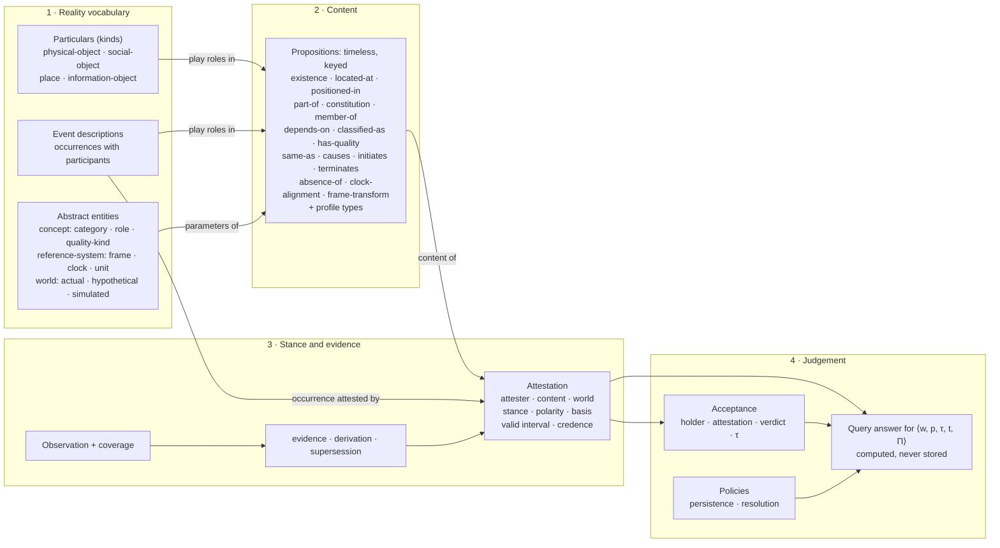
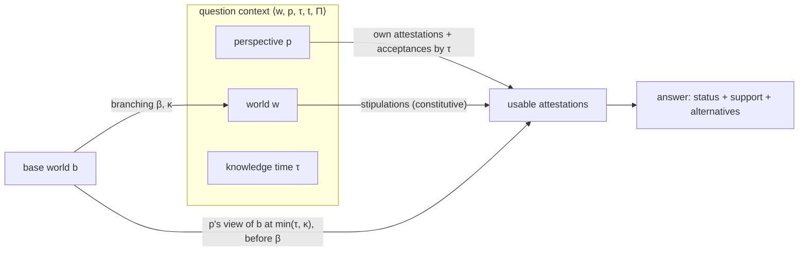

# World Ontology v0.2: architecture proposal

**Status: PROPOSAL for architectural review (2026-11-09). Not approved. Nothing here is implemented.**
Branch `architecture/world-ontology-v0.2`, based on the v0.1 proposal
([world-ontology-v0.1.md](world-ontology-v0.1.md), kept unchanged). `main` and the Milestone 1 code are unchanged.

v0.1 settled the *epistemic* architecture (content, stance, acceptance: design D2). v0.2 keeps D2 and makes the
*ontology of the world itself* precise: what exists, what happens, what changes, and how content is identified.

**Evidence labels:**
- **[V]** verified: a primary source, or a TypeDB 3.14.1 probe in `probes/` (P1-n, P1B-x, A-n, B-n).
- **[M1]** demonstrated by Milestone 1's passing tests or benchmark.
- **[K]** from earlier project research or general knowledge, not re-checked.
- **[H]** argued in this document, not yet demonstrated.

Contents: 1 Summary and diagram · 2 Changes from v0.1 · 3 Ontology of reality · 4 Propositions · 5 Epistemic
architecture · 6 Worlds, snapshots, perspectives · 7 Counterexamples · 8 TypeDB mapping · 9 Decision record ·
10 Milestone 1 migration assessment · 11 What needs experiments

---

## 1. Summary

The world model has **four layers**, and nothing crosses between them except by explicit relations:

1. **Reality vocabulary.** Particulars with identity: physical objects, social objects, places, information objects
   and events. Abstract entities: concepts (categories, roles, quality kinds), reference systems (spatial frames,
   clocks, units) and worlds.
2. **Content.** Propositions: timeless, typed, n-ary statements about particulars ("box-17 is located at shelf-3"),
   stored once each. Plus event descriptions, which are particulars whose occurrence is attested.
3. **Stance.** Attestations: an agent takes a stance on a content, in a world, over a valid interval, with polarity,
   basis and credence. Observations and their coverage are the evidence beneath them.
4. **Judgement.** Acceptances (a perspective accepts or rejects an attestation), and query answers computed for a
   context ⟨world, perspective, knowledge time, valid time, policies⟩.

---

## 2. Changes from v0.1

| Area | v0.1 | v0.2 | Why |
|---|---|---|---|
| Agency | `agent` was an endurant **kind** | agency is a **capacity** (`classified-as` to the concept *agent*); kinds are `physical-object` and `social-object` | a detected "person" may be a mannequin: the physical identity must survive a change of agency (C2), and TypeDB cannot re-type [V] |
| Kinds | listed | kinds are defined by **identity criteria**; profiles add sortal subtypes | makes "fundamental kind" precise (3.1) |
| Events | events as particulars; identity across descriptions open (Q1) | **one event per description**; co-reference by accepted `same-as`; merged views computed | no premature identification (C1) |
| Process, action, transition | not core types | the same, now **defined precisely** as classifications of events | 3.2 |
| Quantities | point values on `has-quality` | **interval-valued** content (lower, upper, canonical unit); measurements are observations | overlapping measurements are compatible, not disputed (C4) |
| Units, frames, clocks | separate | unified as **reference systems** | one rule: values are meaningful only within a reference system |
| Proposition identity | key = type + players | key = **structural identity**, distinct from perspective-relative **semantic equivalence** | identity corrections must not rewrite keys (4.2) |
| Negation | polarity on attestations | the same, plus **one quantified form**: `absence-of(kind, scope)` | negative existentials (W, "no box on shelf 3") |
| Acceptance | per perspective, world-scoped (Milestone 1 review) | per perspective, **world-independent**; variants change inherited content by **stipulation** | acceptance judges a source, not a world (5.3) |
| Inheritance | the system's acceptances | **each perspective inherits its own view** of the base world | several agents can reason in one hypothetical world (6.3) |
| Statuses | 7 statuses | **three layers**: evidence properties, attestation evaluation, answer classification; adds STIPULATED | 5.6 |
| Spatial core | `located-at`, `positioned-in`, frames | minimal and robotics-neutral; topology and regions in profiles | 3.5 |

---

## 3. The ontology of reality

### 3.1 Objects and identity (A)

**Particulars** are individuals that can be identified, re-identified and talked about across records. Each has a
minted id that is never reused. Identity is timeless and world-independent; *existence* is per world (C4 in v0.1).

**Kinds (the TypeDB entity types).** A kind is a category that supplies an instance's **identity criteria**: what
must stay the same for it to be the same thing, and which changes end it. The kind is fixed for the particular's
whole life. Core kinds are deliberately few. Profiles add sortal subtypes with sharper criteria (e.g. `vehicle`,
`rock-sample`, `person`).

| Kind | Meaning | Identity criterion (core default) | Ends when | Distinct from |
|---|---|---|---|---|
| **physical-object** | a material endurant: persons, animals, robots, vehicles, rocks, boxes, samples, amounts of matter (profile subtype) | spatio-temporal continuity of a material body of the same sortal; **not** constancy of parts | destroyed, or transformed into a different kind | place (where things are), information-object (content, not its carrier) |
| **social-object** | a non-material endurant that exists by social recognition: organisations, teams, institutions, legal entities, software services as actors | continuity of its constitutive recognition (founding, registration) | dissolved | physical-object (its members or premises are not it) |
| **place** | a nameable location that can contain things: a room, shelf slot, crater, cabin, a geographic place | continuity of its host or its fixing in a frame | its host is destroyed, or by stipulation | spatial region (an abstract extent in a frame; external geometry) |
| **information-object** | content independent of any carrier: a document, video, dataset, map, message | sameness of content and origin | — (carriers may be destroyed; copies are carriers) | observation (a record of an observing act) |

**Agency is a capacity, not a kind (changed from v0.1).** *Agent* is a concept. A particular is an agent while an
accepted `classified-as(x, agent)` holds. Persons and robots are physical objects with that capacity; organisations
and software services are social objects with it.
- **Semantic reason:** whether something acts intentionally can be uncertain and revisable (C2: a "person" that is a
  mannequin; a robot whose autonomy is disputed). Its physical identity must not depend on that answer.
- **TypeDB reason:** an instance has one type forever [V P1-3, P1B-B].
- **Cost:** "the attester is an agent" is checked by the application, not the schema (TypeDB can still require the
  attester to be a physical or social object).

**Systems are not a kind.** A *system* is any endurant classified as one (`classified-as(x, system)`), with
`part-of` and `depends-on` structure among its components. Vehicles, warehouses, organisations and ecosystems all
fit. A system type would add no answerable question and would force a choice between physical and social (a
company's IT system is both).

**Abstract entities** (no location; timeless in v0.2): **concepts** (categories, roles, quality kinds), **reference
systems** (spatial frames, clocks, units) and **worlds**. They have ids, belong to profiles or to the core
vocabulary, and are referenced by content.

**Creation, destruction, transformation, composition**
| Change | Representation | Identity effect |
|---|---|---|
| Creation | `existence(x)` attested from the creating event's end; optional `initiates(e, existence(x))` | new particular |
| Destruction | an attestation of `existence(x)` with an end (or a superseding attestation with an end); optional `terminates(e, existence(x))` | ends existence in that world; the id remains |
| Transformation into another kind (crate → boards; rock → sample) | old existence ends (or continues, for sampling); new particular's existence begins; `constitution(new, old)` or `derived-from` (profile); one event initiates and terminates | identity is **never** carried across a change of kind |
| Composition change (part removed, replaced) | `part-of(old, whole)` ends; `part-of(new, whole)` begins | the whole persists: physical-object identity does not require constant parts (C3) |
| Amounts of matter (mereologically constant) | profile sortal `portion` whose identity criterion *is* its parts | removing part of a portion ends it: the profile states that |

**Identity uncertainty and correction**
- Observations refer to particulars only through `refers-to(observation, particular)` propositions, which are attested
  and accepted [M1 pattern].
- Two particulars are identified by `same-as` propositions. Only accepted ones merge, transitively; proposed links
  are never chained [M1].
- **Correction:** rejecting a `same-as` acceptance splits the group from that recording time on; earlier views stay
  reproducible [M1].
- **Split of an over-merged particular** (a tracker fused two boxes into one id): mint new particulars, attest new
  `refers-to` links for the observations, and reject the old ones. The old particular keeps only what remains
  accepted. This is awkward (manual reassignment) and is listed in section 11.

**Kind vs classification vs role vs property**
| Question | Answered by | Changes? | Can be uncertain? |
|---|---|---|---|
| *Which one is it?* | identity (id, `same-as`) | never (only corrected) | yes, via proposed links |
| *What sort of thing, essentially?* | kind (TypeDB type) | never | must be robust at minting; otherwise mint as the more general kind |
| *What sort of thing, as described?* ("parcel", "basalt", "agent", "system") | `classified-as` to a category | yes | yes |
| *What function, in which context?* ("site manager at depot 7") | `classified-as` to a role, with context | yes | yes |
| *What value of which quality?* ("mass 3.5 kg", "open") | `has-quality` | yes | yes (ranges, disputes) |

**Foundational vs profile:** the four kinds, agency as a capacity, and the change patterns are foundational. Sortal
subtypes, and categories such as *system*, *person*, *vehicle* or *portion*, belong to profiles.

### 3.2 Events and processes (B)

**Event.** An occurrent particular: something that happens, with participants in roles and a time of occurrence.
Represented as an **event description**: an identified record of one account of an occurrence (who in which roles),
whose occurrence and interval are attested by its source.

| Term | Definition in this ontology | Representation |
|---|---|---|
| **event** | an occurrence with participants | `event` (or a profile subtype) + occurrence attestations |
| **instantaneous event** | an event whose occurrence interval has zero length (start window = end window) | interval on the attestation |
| **extended event** | an event with positive duration | interval |
| **uncertain boundaries** | start and/or end known only within windows | windows; the end may be unknown |
| **process** | an event considered as **homogeneous and ongoing**: any part of it while it lasts is the same kind of happening (charging, eroding, walking) | an event classified by a *process* category; its occurrence interval may be open; persistence policies may cover gaps (C9) |
| **action** | an event in which a participant with the agent capacity plays the `actor` role intentionally | classification of the event (`action` category) **plus** the agent capacity of the actor; intention, if asserted, is a proposition about the actor |
| **state transition** | an event that initiates and/or terminates stative propositions | the presence of `initiates` / `terminates` propositions about it |

**Participants, causes, effects, changes.**
- Participation is a role in the event description (`actor`, `patient`, `instrument`, `location`, `origin`,
  `destination`, plus profile specialisations such as `picker as actor`). A participant's participation lies within
  the event's occurrence and within its own existence (checked).
- Causation is asserted, never inferred from succession: `causes(cause: event, effect: event)`.
- Effects on states: `initiates(event, proposition)` and `terminates(event, proposition)`.
- **None of these is required.** A state may hold with no known initiating event, and an event may have no known
  effect (C5).

**Event identity (resolves v0.1 Q1).** Each source's account is a separate event description. Descriptions are
identified by an accepted `same-as` (the same identity relation used for endurants).
- **No premature identification:** until a `same-as` is accepted, the descriptions are different events in every
  answer.
- **Merged view:** once accepted, questions about the event use all its descriptions. For roles a profile declares
  single-valued for that event kind (e.g. one `picker`), different players are DISPUTED; other roles are unioned.
- **Rejected alternatives:**
  - one canonical event with participations as separate propositions (DOLCE's `PC(x, e, t)`): flexible, but it loses
    typed n-ary roles and makes every event a cloud of propositions;
  - a single shared event written by whoever comes first: premature identification.

### 3.3 Qualities, states and measurements (C)

Using the brief's example, "the mass of an object, a measured value of 3.51 kg, the observation producing it, the
proposition supported by it":

| Notion | Definition | Representation | Example |
|---|---|---|---|
| **quality kind** | a kind of characteristic shared across bearers, with a value space | `quality-kind` concept, with a dimension (mass, length, colour, temperature, open/closed) | *mass* |
| **quality of an entity** | the bearer's characteristic of that kind: the pair (bearer, quality kind) | **not a separate individual**: the *slot* `has-quality(bearer, kind, …)` | rock-R's mass |
| **value / magnitude** | a region of the kind's value space: a numeric interval in a unit, or a category | on the proposition: `lower`, `upper`, canonical `unit`; or a `value` category | [3.47, 3.55] kg; *open* |
| **measurement** | an observing act that yields a result for a quality, with a procedure, instrument and uncertainty | `observation` (subtype `measurement` in a profile): result value, unit, standard uncertainty *u*, coverage factor *k*, conditions | 3.51 kg, u = 0.02 kg, k = 2, balance B-3 |
| **measurement uncertainty** | dispersion of values reasonably attributable to the quantity, given the measurement | on the measurement; it determines the proposition's range [v − ku, v + ku] | ±0.04 kg at k = 2 |
| **proposition supported** | "rock-R's mass lies in [3.47, 3.55] kg" | `has-quality` content; attested with basis observation; evidence → the measurement | — |
| **state** | a stative proposition holding over an interval, read under accepted attestations | not stored separately | "door-3 is open from 10:00" |
| **unit** | a reference system for a dimension | `unit` reference system; content stored in a **canonical unit** per dimension (SI); originals kept on the measurement | kg |

**Why no individual quality instances** (DOLCE's qualities, BFO's qualities as dependent continuants). No question in
the warehouse, social, lunar or hypothetical scenarios needs to refer to "this rock's mass" as an individual beyond
the pair (bearer, kind). The pair is identifiable without a new entity. Profiles that need quality individuals (e.g.
a specific stain or crack) model them as particulars of their own.

**Compatibility of measurements (C4).** Two `has-quality` contents for the same bearer and kind, with overlapping
valid times:
| Ranges | Relationship | Answer for the value |
|---|---|---|
| overlap | **compatible**: both can be true of one underlying value | the intersection, INFERRED by the rule `range-intersection/v1`, citing both; or both ranges, if the caller asks |
| disjoint | **incompatible** | DISPUTED, citing both |
| one contains the other | compatible; the narrower is more informative | the narrower, INFERRED |

The coverage factor must match (both at k = 2, for instance). Otherwise compatibility is UNKNOWN, unless a policy
converts. Quantities that change over time (temperature) are compared only at overlapping times.
**Overlap is decidable in TypeQL** [V B3]; the choice of rule is the application's.

### 3.4 Relations and roles (D)

| Relation | Content | Temporal character |
|---|---|---|
| participation | roles of an event description | bounded by the event's occurrence |
| composition | `part-of(part, whole)` for objects, places and events; `constitution(constituted, constituent)` | contingent: attested intervals |
| location | `located-at(located, place)`; `positioned-in(positioned, frame)` (3.5) | contingent |
| dependency | `depends-on(dependent, dependee)` with a dependency-kind concept (functional, existential, informational) | contingent |
| classification | `classified-as(classified, class, context?)` | contingent |
| membership | `member-of(member, group)` | contingent |
| identity | `same-as(same, same)` | timeless content; accepted at a time |
| social and operational relations | profile proposition types (`employment(employer, employee)`, `assigned-to(agent, task)`) | contingent |

- **Enduring vs time-bounded.** Every contingent relationship is time-bounded by its attestations. "Enduring" means
  a long or open interval, not a different category. Only kinds (types) are permanent.
- **Relationships change without changing identity,** because content is *about* particulars and never part of
  them.
- **Roles at two levels, both kept:**
  1. a **relational position**: a TypeDB role in a proposition or event (`employee`, `actor`), fixed by the content
     type, with no identity of its own;
  2. a **role concept**: an independently identified concept (`site-manager`), held via `classified-as(x, role,
     context)`. It is used when the role is talked about in its own right: who holds it, its history, disputes
     about it.

  A profile may link a role concept to the relational position it corresponds to (e.g. *employee* ↔
  `employment:employee`). The core does not require it.

### 3.5 Space and reference frames (E)

| Notion | Definition | Core representation |
|---|---|---|
| **place** | a nameable location particular (3.1) | entity |
| **spatial region** | an abstract extent in a frame (a polygon, a voxel set, a bounding box) | **not core**: kept in external geometry, referenced by an information-object; profiles may add simple regions |
| **spatial frame** | a coordinate system: origin, axes, units (metres); possibly anchored to a particular | `spatial-frame` reference system; `anchored-to(frame, particular)` proposition |
| **location** | symbolic: a thing is at a place | `located-at` |
| **position and orientation** | metric: coordinates and rotation of a thing in a frame | `positioned-in(positioned, frame)` with per-axis ranges [lower, upper] in canonical units, plus an optional orientation (quaternion components) |
| **spatial relations** | containment (places within places), location | `part-of` between places; `located-at` |
| **frame relations** | how one frame's coordinates map to another's over time | `frame-transform(parent, child)` with translation and rotation, attested over intervals |
| **uncertainty** | positional uncertainty from the measurement | full covariance on the observation; per-axis ranges on the content (a box approximation) |

**Kept out of the core:** topological relations (adjacent, connected, overlaps), distances, named directions,
geographic coordinate systems (a profile maps them to frames), and robotics conventions (`map`, `odom`, `base_link`
are simply frames that a robotics profile names).

**Same object in different frames (C8).** `positioned-in(box, frame-A)` and `positioned-in(box, frame-B)` are
different propositions, both of which can hold. They are related by inference through an accepted `frame-transform`
at that time (rule `frame-transform/v1`). The derived pose is INFERRED and cites the transform's attestation.
**Corrections** of the transform (relocalisation) supersede the transform attestation, and the derived poses are
re-derived [M1-style supersession].

---

## 4. Propositions (content) and time

### 4.1 What a proposition is
A proposition is **structured content**: ⟨type, role bindings, contextual parameters⟩.
- **Type:** a concrete proposition type (`located-at`, `has-quality`, `employment`...).
- **Role bindings:** each role → one particular, event description or concept id (several for multi-player roles such
  as `same-as`).
- **Contextual parameters:** everything else that changes *what is said*: the frame of a position, the quality kind,
  value ranges in canonical units, the context of a role classification.
- **Not part of content:** valid time, world, attester, stance, polarity, basis, credence. All of these are on the
  attestation.

### 4.2 Identity of propositions: three different relations
| Relation | Definition | Decided by | Stable? |
|---|---|---|---|
| **Structural identity** | same type, same role → id bindings, same normalised parameters; equivalently the same canonical key | the **proposition key**, enforced unique by TypeDB `@key` [V A snippet] | yes: keys never change |
| **Semantic equivalence** (relative to a perspective *p* and knowledge time *τ*) | same type and parameters; for each role, the players are co-referential under *p*'s accepted identity at *τ* | computed at query time from accepted `same-as` | **no**: changes as identity is accepted or rejected |
| **Compatibility** | contents that can both be true at once (overlapping ranges; different places for non-functional roles) | type-specific rules (3.3) | rule-dependent |

**A unique database key does not establish semantic equivalence.** "box-17 at shelf-3" and "track-42 at shelf-3" have
different keys. They are equivalent for perspective *p* only while *p* accepts `same-as(box-17, track-42)`.
**Identity corrections never re-key or merge propositions.** They change equivalence classes, so historical
answers stay reproducible.

**Canonical key** (application function, one implementation): `type | role=id,id… (roles sorted, multi-player ids
sorted) | parameter=value… (sorted)`. Numeric parameters are normalised to the canonical unit and printed at a fixed
precision (12 significant digits; open question U3). Keys are an *implementation* identity: they prevent duplicate
storage, nothing more.

**N-ary content** is native: every role is a binding, so `employment(employer, employee, position?)` needs no
reification.

### 4.3 Negation, quantification and scope
- **Negation** is the polarity of an attestation. Contents are positive and atomic. A denial of "B is the site
  manager" attests *the same proposition* with polarity false. So an assertion and a denial share one content, which
  is what makes disagreement detectable.
- **One quantified form in the core:** `absence-of(kind: category, scope: place)` ("no box is on shelf 3"). It is
  supported only by an observation with coverage of that scope and kind (5.5).
- **Other quantification** (universals, counts, generic statements such as "all samples from crater C are basaltic")
  is out of scope for content. Profiles may express such statements as rules (derivations), not as propositions.

### 4.4 Temporal applicability: timeless content, time on stances
**Decision:** propositions are timeless. Temporal applicability belongs to attestations (valid interval with windows,
on a clock).

| Alternative | Problem |
|---|---|
| Time-indexed propositions (the interval is part of content) | an assertion for [10:00, 12:00) and a denial for [11:00, 11:30) become different contents, so their conflict cannot be found by content; every new interval mints a new proposition |
| A separate "situation" layer (content × interval, shared by attestations) | intervals are source-specific, so sharing them adds a layer without adding sharing |
| **Timeless content + intervals on attestations** (chosen) | conflicts are found by content and compared by interval; one proposition per content |

**Worked demonstrations**
- **Changing location.** One content per place: `located-at(box, shelf-3)` and `located-at(box, dock)`. The robot's
  attestations: shelf-3 over [10:00, 10:10), dock from 10:10. At 10:05 the answer is shelf-3; at 10:15 it is dock;
  at 10:15 "shelf-3?" is false, INFERRED by functional exclusivity.
- **Employment.** One content: `employment(employer: acme, employee: B)`.
  - A attests [Jan, Jun), with a stated end.
  - B attests from Feb, end unknown, with an observed-at in Aug, so certainly until Aug.
  - Both accepted by the system: Feb–Jun TRUE (both); before Feb, A alone; Jun–Aug DISPUTED (A's stated end vs B's
    ongoing claim). One content made the conflict visible.
- **Scientific measurement.** Content `has-quality(rock-R, mass, [3.47, 3.55] kg)` from measurement m1, and
  `has-quality(rock-R, mass, [3.45, 3.53] kg)` from m2. Two contents (different ranges), compatible: the value is in
  [3.47, 3.53] kg, INFERRED (`range-intersection/v1`).
- **Hypothetical situation.** In world *plan-B*, the planner stipulates `located-at(box, bay-4)` from 12:30. It is
  the same content type as actual-world facts; the stance is `stipulates` and the world is *plan-B*. In plan-B the
  answer is STIPULATED. In the actual world nothing changes.

### 4.5 Time and clocks
Unchanged from v0.1 except for terminology:
- clocks are **reference systems**;
- valid time = attestation interval; event time = occurrence interval; observation time = phenomenon interval;
  transaction time = `recorded-at`; belief time = interval of a `believes` attestation, or the time of a
  perspective's acceptance;
- times on different clocks compare only through an accepted `clock-alignment` (with its uncertainty widening the
  windows). Otherwise the comparison is UNKNOWN.

---

## 5. Epistemic architecture

### 5.1 The five constructs
| Construct | Is | Is not |
|---|---|---|
| **proposition** | what is represented (content) | true, false, believed or timed |
| **attestation** | an agent's stance on a content in a world over an interval, with a basis | accepted by anyone else; evidence for itself |
| **acceptance** | a perspective's decision about an attestation, at a recording time | truth; a property of the content |
| **evidence** | an observation (or attestation) that supports or undermines an attestation, with a method | a decision |
| **query answer** | a computed conclusion for a context ⟨world, perspective, τ, t, policies⟩ | stored |

### 5.2 Invariants
| # | Invariant | Enforced by |
|---|---|---|
| E1 | an attestation has exactly one attester, one content and one world; it has a polarity, a basis and a recorded-at | TypeDB (`@card(1..1)` on roles; required attributes checked on write) |
| E2 | the attester has the agent capacity (or is the system's reasoner) | application |
| E3 | attestations are never edited; a change of mind is a new attestation plus `supersession` (same attester only) | application (no update API) + check |
| E4 | acceptance targets attestations only; the latest acceptance by the same holder up to τ decides; a rejection wins ties | TypeDB (role types) + application (ordering) |
| E5 | evidence alone accepts nothing; acceptance by evidence happens only through a named acceptance policy | application |
| E6 | a derived attestation names its rule (id, version) and premises; its attester is the reasoner that ran the rule. For a perspective, it is usable only while **all its premises are usable** for that perspective, so rejecting a premise withdraws the conclusion without editing anything | application |
| E7 | `stipulates` is allowed only in hypothetical and simulated worlds. Stipulations are **constitutive**: they hold in that world for every perspective and are not subject to acceptance | application (world kind) |
| E8 | a reported belief (A believes p) is an attestation with attester A and stance `believes`. The report it came from is evidence (an observation of A's testimony) | application |
| E9 | answer statuses are never stored | design |
| E10 | presumptions are never stored; they are computed from named, versioned policies | design |

### 5.3 Clarifications requested
- **What acceptance attaches to:** the attestation. Accepting a proposition would lose *whose* claim, *over which
  interval* and *on what basis* is being trusted. Accepting evidence is expressed by accepting (or not) the
  attestations derived from it.
- **Acceptance is world-independent.** It judges a source's claim, and the claim already names its world. To change
  inherited content inside a hypothetical world, the variant **stipulates** (including stipulated denials). It never
  "rejects" the base's attestation. This replaces Milestone 1's world-scoped reviews and keeps acceptance meaning one
  thing.
- **Several attestations of the same proposition (corroboration):** the answer holds at t if any accepted positive
  attestation certainly holds at t. All of them are cited, with the count of independent sources (distinct attesters
  and evidence). They are never combined into a probability.
- **Explicit denials:** an attestation with polarity false. A denial and an assertion of the same content, both
  accepted by *p* and both certain at t, make *p*'s answer DISPUTED.
- **Agent beliefs vs system acceptance:** *A's* perspective consists of A's own attestations plus A's acceptances. The
  system's perspective consists of the system's attestations, its acceptances and the stipulations of the world.
  Neither is truth. Every answer is labelled with its perspective, and the system's perspective is only the default.
- **How observations, testimony and inference contribute:** through the basis of the accepted attestations an answer
  rests on: observation → OBSERVED (only within observed times), testimony → ASSERTED, inference → INFERRED,
  stipulation → STIPULATED.
- **Dispute detection (within one perspective at t):**
  1. polarity conflict on equivalent contents;
  2. functional conflict: incompatible values for a single-valued slot (two places; disjoint ranges; two players of
     a single-valued event role);
  3. presumption against presumption.

  Supported answers never dispute with presumed ones; the presumption yields.
- **Dispute resolution:** only by acceptance decisions (reject one side), or by a named **resolution policy** (for
  example "prefer calibrated instruments") whose use the answer cites. **Never silent.**

### 5.4 Defeasible persistence and evidence
A persistence policy fills only gaps where no accepted attestation decides t. It begins at the last positive support
and lasts until its horizon, unless defeated:
- **defeated by** any supported contrary (positive incompatible content, or negative polarity) of standing
  observed, asserted or inferred;
- **disputed by** weak negatives (absence observations below the policy's reliability threshold);
- **renewed by** new positive support.

Policies are data (id, version, scope, horizon, defeaters), and they are never applied to kinds they don't name
(v0.1 / Phase 1C semantics, unchanged).

### 5.5 Observed absence vs missing observations
- **Missing observation:** no coverage of the scope at t. **No evidence** either way.
- **Observed absence:** an observation with coverage (scope, interval, target kinds, reliability) and no detection
  of the target. It supports a negative-polarity attestation of `located-at(x, place)`, or a positive attestation of
  `absence-of(kind, place)`, only if the reliability meets the policy threshold under the recorded conditions.
  Below it, the negative is weak and only disputes presumptions.
- **Absence of x from a place says nothing about where x is.**

### 5.6 Status vocabulary: three layers
| Layer | Terms | Where it lives |
|---|---|---|
| **1. Evidence properties** (facts about records) | basis (observation, testimony, inference, stipulation); model score; measurement uncertainty (u, k); coverage reliability; credence; independence of sources | stored on observations and attestations |
| **2. Attestation evaluation** (for a perspective at τ and t) | acceptance state: accepted / rejected / unreviewed / superseded; temporal verdict: holds / does-not-hold / undecided | computed |
| **3. Answer classification** (for a question in a context) | see below, each with polarity and support | computed, returned, never stored |

| Answer status | Precise meaning (for perspective *p*, world *w*, knowledge time τ, valid time t) |
|---|---|
| **OBSERVED** | an attestation accepted by *p* with basis observation holds at t, and t lies within the phenomenon interval of an observation that supports it |
| **ASSERTED** | an attestation accepted by *p* with basis testimony holds at t |
| **STIPULATED** | a stipulation of *w* (or inherited from its base within the snapshot) holds at t |
| **INFERRED** | an accepted derived attestation holds at t, or a declared query-time rule concludes it (functional exclusivity, range intersection, frame transform) |
| **PRESUMED** | none of the above decide t; a persistence policy carries an earlier supported answer to t |
| **DISPUTED** | answers of equal standing for *p* disagree at t (5.3) |
| **UNKNOWN** | records about the content are visible at τ, but none decides t for *p* |
| **NOT_YET_KNOWN** | nothing about the content is visible at τ |

Standing: OBSERVED, ASSERTED, STIPULATED and INFERRED are **supported**, with no default order between them (an
observation does not automatically beat testimony; a resolution policy may say so). Supported > PRESUMED.

---

## 6. Worlds, knowledge snapshots and perspectives

### 6.1 The three dimensions
| Dimension | Represents | Parameter |
|---|---|---|
| **World** *w* | a reality (actual), a stipulated alternative (hypothetical) or a generated one (simulated) | which world's attestations count |
| **Knowledge snapshot** τ | what had been recorded by a transaction time | which records count |
| **Perspective** *p* | an agent's view: its own attestations plus its acceptances | whose judgements count |

Every question is asked in a **context** ⟨w, p, τ, t, Π⟩ (Π: policies, plus the clock of t). These dimensions are
orthogonal:
- the same world can be viewed from many perspectives;
- the same perspective at different τ;
- a hypothetical world is not anyone's belief, and a belief is not a world.

### 6.2 Visibility
Within ⟨w, p, τ⟩, the usable attestations are:
1. **Own:** attestations in *w* recorded by τ, that *p* made or *p* accepted by τ (latest decision), plus all
   stipulations of *w*.
2. **Inherited** (if *w* is a variant of base *b*, with `branch-at` β and `knowledge-at` κ): the attestations usable
   in ⟨b, p, min(τ, κ)⟩, restricted to valid times before β (their starts before β; their endings counted only
   before β).
3. **Nested** variants apply the rule recursively: the tightest β and κ along the path [M1].

Unaccepted attestations by others are returned as **alternatives**, never as support.

### 6.3 Resolutions
- **Whose acceptances does a hypothetical world inherit?** *Each perspective's own.* An agent reasoning in plan-B
  sees plan-B's stipulations plus its own view of the base world at κ. Two agents can therefore reason in the same
  hypothetical world: they share its stipulations and may differ on what they inherited. The system's perspective is
  the default, as everywhere.
- **Later corrections in the base** (new attestations, acceptances or supersessions recorded after κ) never reach
  the variant [M1]. To adopt them, branch again (a new world with a later κ). Re-basing an existing world is
  deliberately not offered, because it would silently change the world's meaning.
- **Different clocks.** `branch-at` is a time on a named clock. If the variant's content uses another clock
  (simulation time), branching requires an accepted alignment between the two clocks at creation (invariant). Without
  it, base content with a time is not inherited.
- **Simulated worlds** are worlds of kind simulated, with their own clock and an optional `models(simulated, actual)`
  link. A simulation's outputs are attestations by the simulator (basis stipulation within the simulated world). They
  never become actual-world evidence unless someone attests that explicitly.

---

## 7. Counterexamples, represented and answered

Each case gives the records, then what is **justified**, **disputed** and **unknown** in the system's perspective
unless stated otherwise, then any **awkwardness**.

**C1. Two agents describe the same event differently.** A says Bob picked up the box at about 10:05; B says Carol
picked it up at 10:06.
- *Records:* event descriptions e1 (actor bob, patient box; kind *pickup*) attested by A over [10:04, 10:06], and e2
  (actor carol, patient box; *pickup*) attested by B at 10:06. A proposed `same-as(e1, e2)` (from a matcher: same
  patient, overlapping time).
- *Before acceptance:* two pickups, each ASSERTED; "who picked up the box at about 10:05?" lists two events. Nothing
  is merged.
- *After acceptance:* one pickup; `picker` is single-valued for *pickup* (profile) → actor DISPUTED (bob, carol);
  time: windows intersect, [10:06, 10:06].
- *Awkward:* single-valued event roles need profile metadata.

**C2. Classification changes, physical identity does not.** A camera sees a "person" at the door at 09:00; at 09:30
an operator says it is a mannequin.
- *Records:* physical-object m-1 (minted on first detection). `classified-as(m-1, person)` (basis observation,
  detector score 0.81) and `classified-as(m-1, agent)` (inference, rule `person-implies-agent/v1`). Later, the
  operator's testimony `classified-as(m-1, mannequin)`, a denial of `classified-as(m-1, person)`, and the system
  rejects the detector's attestation.
- *Answers:* m-1 has one identity throughout. At 10:00, person: ASSERTED false; mannequin: ASSERTED; agent: the
  inference's premise is rejected, so its conclusion is no longer usable (E6): UNKNOWN, unless someone asserts it. As known
  at 09:15 the system's view was still "person".
- *Contrast:* with `agent` as a kind (v0.1), m-1 would have to be re-minted and its history split. That is the
  reason for DR-02.

**C3. A component removed and replaced.** Rover R's battery b1 is replaced by b2 at sol 12.
- *Records:* `part-of(b1, R)` attested to the swap event's start, `part-of(b2, R)` from its end;
  `terminates(swap, part-of(b1,R))`, `initiates(swap, part-of(b2,R))`; b1 continues to exist (now in storage).
- *Answers:* R is the same rover before and after (its identity criterion does not require constant parts). The
  battery at sol 11 is b1 and at sol 13 is b2. "Which parts did R ever have?" lists both, with intervals.
- *Awkward:* none.

**C4. Two measurements with overlapping uncertainty.** m1: 3.51 kg (u 0.02, k 2) → [3.47, 3.55]. m2: 3.49 kg (u
0.02, k 2) → [3.45, 3.53].
- *Records:* two `has-quality(rock-R, mass, range)` contents, attested with basis observation and evidence m1, m2.
- *Answers:* compatible; mass in [3.47, 3.53] kg, INFERRED (`range-intersection/v1`, citing both). A third
  measurement at [3.70, 3.74] makes the value DISPUTED against both.
- *Awkward:* different coverage factors (k = 2 vs k = 3) need a conversion policy; without one, UNKNOWN.

**C5. A state with no known initiating event.** "Door 3 was open at 10:00" (inspection), with no record of opening.
- *Records:* `has-quality(door-3, open-state, open)` attested over [10:00, 10:00] with basis observation.
- *Answers:* OBSERVED at 10:00. At 10:20, PRESUMED only if a door-state policy exists (else UNKNOWN). "What opened
  it?" UNKNOWN. Nothing requires an event.
- *Awkward:* none.

**C6. Denied by one agent, accepted by another.** A asserts `classified-as(B, site-manager, context: depot-7)` from
Monday; B denies it (same content, polarity false). The system accepts A's attestation; the operations lead accepts
B's.
- *Answers:* system perspective ASSERTED true (citing A, with B's denial as an alternative). Operations lead's
  perspective ASSERTED false. A's perspective: true. B's: false. "Where do the system and the lead disagree?" returns
  this content.
- *Awkward:* none. (It was impossible in Milestone 1, which had no polarity or holders.)

**C7. A correction after a hypothetical world branches.** Plan-B branches from actual at β = 12:00 with κ = τ₁. At τ₂
the actual world learns the box was at shelf-4 (not shelf-3) since 10:00: a new attestation and a rejection of the
old one.
- *Answers:* actual: shelf-4 from 10:00. Plan-B (system perspective): shelf-3, because the snapshot is at τ₁. A new
  variant plan-B′ with κ = τ₂ sees shelf-4. Plan-B's own stipulations are unaffected [M1 test].
- *Awkward:* users must know that adopting a correction means branching again (by design).

**C8. One object in different coordinate frames.** The box's pose is observed in camera frame cam-1. The question is
asked in frame map-1.
- *Records:* `positioned-in(box, cam-1, ranges)` (observation); `frame-transform(map-1, cam-1, …)` attested over
  [10:00, 10:30].
- *Answers:* pose in map-1 INFERRED (`frame-transform/v1`, citing both). After a relocalisation supersedes the
  transform at 10:20, poses after 10:20 are re-derived. As known before the supersession, the old poses stand.
- *Awkward:* ranges through a rotation become boxes containing the rotated box, which is conservative.

**C9. A process continuing through an observation gap.** The rover is observed charging at 14:00 and at 16:00; no
coverage in between.
- *Records:* event c (kind *charging*, a process) with occurrence attested from 14:00, end unknown; observations at
  14:00 and 16:00 support it; policy `charging/v1` (horizon 4 h; defeated by a *charging stopped* event or an
  observation of not charging).
- *Answers:* OBSERVED at 14:00 and 16:00; PRESUMED at 15:00; at 21:00 UNKNOWN (beyond the horizon from 16:00).
  Without the policy, 15:00 is UNKNOWN.
- *Awkward:* none, but the policy must exist.

**C10. A hypothetical entity with no actual-world existence.** Plan-B stipulates a spare robot r-9, created at
12:30, which moves the box at 13:00.
- *Records:* referent r-9 (identity global). In plan-B: stipulations of `existence(r-9)` from 12:30,
  `classified-as(r-9, agent)`, an event e (actor r-9, patient box) and `located-at(box, bay-4)` from 13:00.
- *Answers:* plan-B: r-9 exists (STIPULATED); the box is at bay-4 after 13:00 (STIPULATED). Actual: r-9
  NOT_YET_KNOWN; no answer mentions it; `find("spare robot", world=actual)` returns nothing [M1].
- *Awkward:* none.

**Extra counterexamples found during this review**
- **C11. Over-merged identity** (one track was two boxes). It needs manual split: new particulars, new `refers-to`
  attestations, rejection of the old ones. Workable, but awkward; there is no single "split" operation (open
  question U4).
- **C12. Cross-clock question** ("was the sample taken before the UTC dust event?") with no accepted alignment
  answers UNKNOWN. With alignment ±2 s, the windows widen by 2 s and the order is decided only if they still separate.

**Cases needing special-purpose logic:** single-valued event roles (C1) and conflicting coverage factors (C4) need
profile metadata; identity split (C11) needs a procedure; frame derivation (C8) needs a geometry routine. Everything
else is general.

---

## 8. TypeDB mapping

### 8.1 Four layers of responsibility
| Layer | Holds |
|---|---|
| **Ontological commitments** (this document) | categories, definitions, invariants E1-E10, statuses, policy semantics |
| **TypeDB schema** | kinds and their roles; proposition types; attestation arity (`@card(1..1)`); unique keys (ids, proposition keys); value domains (stance, polarity, basis, verdict, world kind); multi-player roles (`same-as @card(2..2)`) [V] |
| **TypeQL queries and functions** | selection from a bound subject through content to attestations, by world, τ and interval [V B1]; polymorphic content [V B2]; range overlap [V B3]; transitive closures [V]; certain-interval checks [V P1B-C] |
| **Python** | canonical keys; acceptance ordering; perspective views and inheritance; status classification; persistence and resolution policies; coverage; clock alignment and frame transforms; range intersection; E2, E3, E5-E8 |

### 8.2 Conceptual → physical
| Conceptual | TypeDB |
|---|---|
| kinds | entities `physical-object`, `social-object`, `place`, `information-object` (sub abstract `particular`); profile sortals subtype these |
| event descriptions | relation `event` with participant roles, `wm-id @key`; plays `attestation:content`, `same-as:same`, proposition roles (`causes`, `initiates`...) |
| concepts, reference systems, worlds | entities `category`, `role`, `quality-kind` (sub `concept`); `spatial-frame`, `clock`, `unit` (sub `reference-system`); `world` |
| propositions | abstract relation `proposition` with `proposition-key @key`; concrete subtypes; parameters as attributes (`lower`, `upper` doubles; canonical unit as a role to `unit`, or as an attribute) |
| attestation | relation `(attester, content, context)` with `@card(1..1)` each; owns stance, polarity, basis, credence, valid-time windows, `recorded-at`, `wm-id @key` |
| acceptance, evidence, derivation, supersession | relations with `recorded-at`, `wm-id @key` |
| observation, coverage | entity `observation` (owns phenomenon and result times, result value, u, k, model score, raw reference); relation `coverage (observation, scope, target-kind)` with reliability |
| policies, rules | entities with name and version |

### 8.3 Compromises, made explicit
| # | Compromise | Driven by | Semantic cost |
|---|---|---|---|
| T1 | kinds limited to identity sorts; agency as a capacity | **semantics** (C2), reinforced by TypeDB's single type [V] | "attester is an agent" checked in Python |
| T2 | value ranges as two attributes on the proposition; uncertainty on observations | attributes cannot own attributes [V P1-5] | none: the range is the content |
| T3 | coordinates and quaternions as separate double attributes | structs unusable in 3.14.1 [V] | verbose schema |
| T4 | proposition keys computed in Python | TypeDB has no "unique by role players" constraint [V A1] | one function must be the only writer of keys |
| T5 | inference as query-time functions and Python | no stored rules in TypeDB 3 [K] | rules are code, versioned by id |
| T6 | explicit `@card` on multi-player roles | role default is one player per instance [V B2] | none |
| T7 | single-valued event roles and functional slots as profile metadata (data), checked in Python | TypeDB cannot express "one value at a time" over attested intervals | not schema-enforced |

### 8.4 Does D2 remain practical?
| Concern | Evidence | Assessment |
|---|---|---|
| Identity | keys unique and enforced [V]; equivalence by accepted identity in Python [M1] | practical |
| Indexing and selective retrieval | anchored subject → proposition → attestation queries; same answers as the one-hop form; median 22.9 ms vs 20.6 ms on 1,200 facts [V B1]; Milestone 1's selective path 23.8 ms vs 1,822 ms for whole-world loads [M1] | practical at tested sizes; larger untested |
| Polymorphism | one content role for all proposition types and events; abstract supertype queries [V A4, B2] | practical |
| Temporal filtering | interval predicates on attestation attributes inside TypeQL [V B1, P1B-C] | practical |
| Write cost | extra key computation and one more record per fact; ingest 4.2 s vs 3.2 s for 1,200 facts [V B1] | acceptable [H] |

---

## 9. Architecture decision record (ADR-001 revised, proposed)

Each decision: alternatives → choice → rationale → TypeDB → trade-offs → Milestone 1 consequence.

| ID | Decision | Alternatives rejected | Rationale | TypeDB | Trade-offs | M1 consequence |
|---|---|---|---|---|---|---|
| DR-01 | **Content / stance / acceptance separation (D2)** | D1 direct claims; D3 event-centric | denials, multiple holders, perspectives (v0.1 §9) | relations as players [V] | one more hop (≈1.1× median [V B1]) | replace `claim` with `proposition` + `attestation` |
| DR-02 | **Kinds are identity sorts; agency is a capacity** | `agent` as a kind (v0.1) | C2: identity must survive revised agency | single type [V] | attester agency app-checked | `agent` → `physical-object` / `social-object` + classification |
| DR-03 | **No system kind** | system type | no answerable question needs it; physical/social ambiguity | — | queries for systems join a classification | none (none existed) |
| DR-04 | **Events are identified descriptions; co-reference by accepted `same-as`** | participation propositions; one canonical event | no premature identification (C1); keeps n-ary roles | events as relation players [V B2] | merged views computed; single-valued roles need metadata | `event` retained; add to `same-as` players |
| DR-05 | **Process, action, transition are event classifications** | separate types | definitions in 3.2 suffice; C9 shows processes work | — | — | none |
| DR-06 | **Qualities as (bearer, kind) slots with values; no quality individuals** | DOLCE/BFO quality individuals | no scenario question needs them | values typed [V A2b] | profiles needing quality individuals add particulars | `has-state` → `has-quality` |
| DR-07 | **Interval-valued quantities; measurements are observations; compatibility by overlap** | point values with tolerance rules | C4: compatible measurements must not dispute | overlap in TypeQL [V B3] | coverage factors must match | new |
| DR-08 | **Reference systems: frames, clocks, units; canonical units in content** | units as strings; clocks as strings (M1) | one rule for all values | entities | conversion code needed | `clock` string → `clock` entity |
| DR-09 | **Roles at two levels: relational positions and role concepts** | only one of them | both are used in S and W | roles + `classified-as` with context | two ways to say related things (guidance needed) | add `context` role |
| DR-10 | **Minimal space core: place, frame, `located-at`, `positioned-in`, `frame-transform`** | regions and topology in core | robotics-neutral, lightweight | doubles for coordinates [V] | box approximations of uncertainty | new |
| DR-11 | **Timeless propositions; time on attestations** | time-indexed propositions; situation layer | conflicts found by content (4.4) | interval filters on attestation [V B1] | — | move windows to attestations |
| DR-12 | **Structural key ≠ semantic equivalence; no re-keying on identity change** | merging propositions on identity acceptance | reproducible history; perspective-relative identity | `@key` [V] | equivalence classes computed per query | new |
| DR-13 | **Negation by polarity; one quantified form `absence-of`** | negative propositions; general quantifiers | shared content for assertion and denial | boolean attribute | other quantification only as rules | add polarity |
| DR-14 | **Acceptance on attestations, world-independent; variants change content by stipulation** | world-scoped reviews (M1); acceptance on propositions | acceptance judges sources, not worlds | relation | variant authors stipulate denials | `review` → `acceptance`; world-scoped review semantics replaced |
| DR-15 | **Three-layer status vocabulary; add STIPULATED** | statuses stored on claims | statuses depend on context | — | — | add OBSERVED, PRESUMED, STIPULATED |
| DR-16 | **Context ⟨w, p, τ, t, Π⟩; each perspective inherits its own base view** | system-only inheritance (v0.1 lean) | several agents in one hypothetical world | — | inheritance cost per perspective [H] | generalise snapshot code |
| DR-17 | **Cross-clock comparison and branching only through accepted alignments** | implicit UTC | C12 | — | more UNKNOWN answers | new |
| DR-18 | **Presumptions computed from named policies; disputes resolved only by acceptance or named policies** | stored presumptions; silent tie-breaks | auditability | policies as data | policy authoring burden | new |

**Rejected outright:** BFO-realist foundation; DUL's Descriptions and Situations reification; individual quality
instances in the core; an `agent` kind; a `system` kind; stored answer statuses; time-indexed propositions;
re-keying propositions on identity merges; acceptance on propositions; world-scoped acceptance.

---

## 10. Milestone 1 migration assessment (updated)

| Milestone 1 component | v0.1 verdict | **v0.2 verdict** |
|---|---|---|
| `referent` kinds `physical-object`, `agent`, `place`, `concept` | retain | **adapt**: `agent` → `social-object` + agency classification; add `information-object`; concept subtypes |
| `world`, `branching` (`branch-at`, `knowledge-at`), snapshot semantics, isolation | retain | **retain**, generalised to per-perspective views |
| world-scoped `review` | adapt to acceptance | **replace**: world-independent `acceptance`; variants use stipulations |
| `claim` relation carrying time, world, status | replace | **replace** by `proposition` + `attestation` |
| claim types `located-at`, `part-of`, `member-of`, `depends-on`, `classified-as`, `same-as`, `existence` | retain as propositions | **retain** (`classified-as` gains `context`; `same-as` also takes events) |
| `has-state` | replace | **replace** by `has-quality` (categorical or interval) |
| `event`, six roles, kinds by classification | retain | **retain**; occurrence attested; co-reference via `same-as` |
| `cessation`, `initial-status`, `consequence` | replace | **replace** by supersession / attested ends, acceptance, `initiates`/`terminates` |
| valid-time windows, end basis | move to attestations | **move**; `until-ceased` → stipulated end basis (defined worlds) |
| `clock` string | replace | **replace** by `clock` reference system + alignment |
| `scope` relation | remove | **remove** (world is a role of attestation) |
| `FUNCTIONAL` registry | profile metadata | **profile metadata**, also for single-valued event roles |
| identity closure, existence semantics, selective query path, `typeql.py`, tests, benchmark | retain | **retain**; the tests become the behavioural specification |
| answer statuses | add OBSERVED, PRESUMED | add OBSERVED, PRESUMED, **STIPULATED**; polarity on all |

**Migration plan (after approval; unchanged in shape):**
1. Core 0.3 schema as new module files.
2. Port Milestone 1's 41 tests as specifications.
3. Content and stance layer, acceptance, statuses; then worlds and perspectives; then identity; then the selective
   path.
4. Add the C1-C12 counterexamples as tests.
5. Re-run the benchmark (target: p95 within 2× of Milestone 1).
6. Retire 0.2. No persistent data exists, so nothing needs migrating.

**Expensive-later mistakes avoided by doing this now:** content/stance conflation; agency as a kind (re-minting on
reclassification); point-valued measurements (false disputes); world-scoped acceptance; clocks as strings.

---

## 11. What genuinely needs experimental validation
| # | Uncertainty | Experiment |
|---|---|---|
| U1 | Two-hop retrieval at 10-100× the tested size, and the cost of per-perspective inheritance | scale the B1 benchmark; add perspectives and variants |
| U2 | Whether interval-valued quantities with overlap and intersection give sensible answers on real measurement series | the lunar scenario with realistic instrument noise |
| U3 | Canonical keys for numeric parameters (precision, unit normalisation): false duplicates or false distinctions | property tests over generated values |
| U4 | Identity split procedure (C11): correctness and cost | a scripted over-merge scenario |
| U5 | Whether agency-as-capacity makes ordinary queries ("all agents present") awkward or slow | query timing with the classification join |
| U6 | Whether one persistence policy per kind is enough, or policies need conditions | warehouse and process scenarios |
| U7 | Event co-reference workflow (who proposes `same-as` for events, on what evidence) | the social scenario with conflicting reports |

Everything else in this document is a design decision to be approved or changed, not an experiment.
